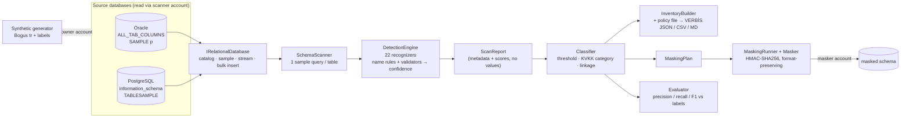
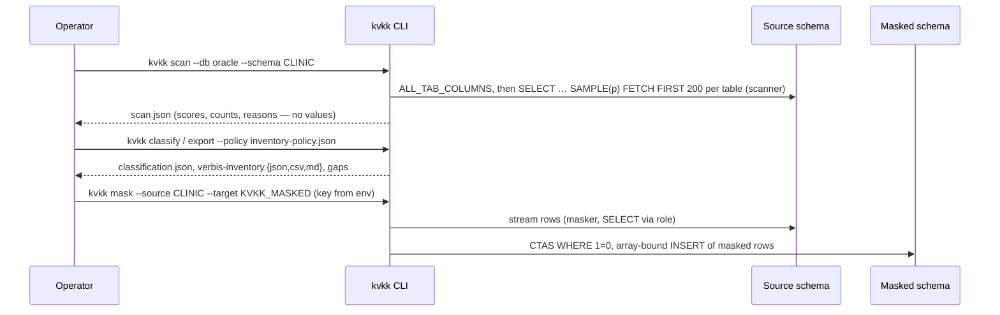

# kvkk-data-inventory

[](https://github.com/hekimcan206/kvkk-data-inventory/actions/workflows/ci.yml)
[](https://github.com/hekimcan206/kvkk-data-inventory/actions/workflows/codeql.yml)


[](LICENSE)

A **KVKK data inventory and masking tool** for Oracle and PostgreSQL. It finds personal data in a database,
classifies it into KVKK / VERBİS categories, masks it into a separate schema (deterministic, checksum-preserving),
generates synthetic test data, and exports a VERBİS-style personal-data inventory. Built with .NET 10.

> **All data is synthetic; there is no real personal or health data in this repository.** TCKNs, IBANs and
> card numbers are random numbers with valid checksums. Purposes, legal bases and retention periods in the
> sample policy are illustrative, not legal advice.

## Problem

**KVKK** (*Kişisel Verilerin Korunması Kanunu*, Law No. 6698 — Türkiye's GDPR counterpart) requires a data
controller to know which personal data it processes, why, on what legal basis, for how long and who receives
it. Controllers above the thresholds register this in **VERBİS** (*Veri Sorumluları Sicil Bilgi Sistemi*, the
Data Controllers' Registry): for each data subject group, the data categories, processing purposes, recipient
groups, planned transfers abroad, security measures and maximum retention periods (Regulation on the Data
Controllers' Registry, Art. 9). **Special categories** (Art. 6: health, biometric and genetic data, religion,
political opinion, ethnic origin, union / association membership, criminal convictions, …) may only be
processed under the narrow Art. 6 conditions.

In practice the inventory is a spreadsheet filled from interviews, while the truth is in a 20-year-old Oracle
schema with columns named `TC_NO`, `ACIKLAMA` and `HASTA_ADI`, plus a PostgreSQL system nobody documented.
And every test environment holds a copy of production with real TCKNs in it, because masking breaks the
checksum validation the application performs.

## Solution

| Capability | How |
|---|---|
| **Scan** Oracle and PostgreSQL | One `IRelationalDatabase` abstraction; catalog from `ALL_TAB_COLUMNS` / `information_schema` (+ comments, row estimates); one sample query per table using `SAMPLE (p)` / `TABLESAMPLE BERNOULLI` on large tables ([ADR 0004](docs/adr/0004-one-catalog-abstraction-and-sampling.md)) |
| **Detect** 22 PII types | Turkish + English column-name rules **and** validated value samples — TCKN and VKN check digits, IBAN mod-97, Luhn + issuer prefix (incl. TROY), Turkish phone numbering, plates, ICD-10, address markers, name lexicons — combined into a confidence with an explanation ([ADR 0001](docs/adr/0001-detection-names-values-checksums.md)) |
| **Classify** into KVKK categories | VERBİS data categories (Kimlik, İletişim, Finans, Özlük, Sağlık Bilgileri …), special-category flag, data-subject linkage so ICD-10 *catalogs* are not health data ([ADR 0003](docs/adr/0003-subject-linkage-and-metadata-only-scan-output.md)) |
| **Mask** into a separate schema | HMAC-SHA256 keyed pseudonyms: deterministic across tables, runs and engines; TCKN / VKN / IBAN / card still pass their checksums; partial masking, generalisation, synthetic names, nulling of special categories ([ADR 0002](docs/adr/0002-keyed-one-way-masking-and-masked-copy.md)) |
| **Synthesise** test data | Bogus (`tr`) generator for a labelled clinic + HR schema with valid-checksum identifiers and deliberate decoys; same seed → same data on both engines |
| **Export** a VERBİS-style inventory | Classification × policy file → JSON, CSV (Excel-ready, Turkish headers) and Markdown, with **gaps** where a category found in the database has no documented purpose / retention |
| CLI + API | `kvkk scan · classify · mask · synth · export · evaluate · pipeline`; minimal API `/api/v1/detect`, `/scans`, `/inventory` |

Samples: [VERBİS inventory (Markdown)](docs/samples/verbis-inventory.md) · [CSV](docs/samples/verbis-inventory.csv) ·
[JSON](docs/samples/verbis-inventory.json) · [masking before/after](docs/samples/masking-sample.md) ·
[Oracle run from the compose demo](docs/samples/oracle) (scan, classification, accuracy, inventory).

## Architecture





## Why this design

- **Names *and* values, validated.** Names alone miss phone numbers in a `notlar` column and are fooled by
  `ilac_adi`; values alone cannot tell a birth date from a hire date or see coded union membership. Checksums
  turn weak patterns into strong evidence: a random 11-digit number passes the TCKN check about 1 % of the
  time (measured in a test: 0.8–1.2 %). The ablation shows each source alone loses 0.10–0.15 F1.
- **Linkage before special categories.** KVKK's strictest rules attach to data *about a person*. A table with no
  identifier and no person reference is treated as reference data and its "health" findings are suppressed
  (but listed).
- **One-way pseudonyms, not encryption.** HMAC keeps masked data joinable and checksum-valid without making it
  decryptable; FF1/FF3-1 format-preserving encryption would hand every key holder a decryption oracle.
- **Copy, never update.** The source is only read. A failed masking run cannot leave production half-masked.
- **Scan output is metadata.** A discovery tool must not become the biggest copy of the data it discovers.
- **Least privilege is tested, not assumed.** Owner, scanner and masker accounts come from the same init scripts
  in docker compose and in the Testcontainers tests; tests prove the scanner cannot see ungranted tables or
  delete rows.

## Quick start

```bash
docker compose up        # PostgreSQL 17 + Oracle 23ai Free; seeds, scans, exports and masks both; starts the API
```

`demo-postgres` and `demo-oracle` each print the accuracy against the ground truth and exit 0:

```text
[oracle] seeded 7000 synthetic rows into 14 tables
[oracle] scanned 14 tables / 99 columns in 1218 ms: 49 findings
[oracle] accuracy vs ground truth: precision 0.939, recall 0.939, F1 0.939
inventory: 25 entries, 7 gaps → /out
[oracle] masked copy CLINIC → KVKK_MASKED: 7000 rows in 2174 ms
PIPELINE_OK oracle f1=0.939 masked_rows=7000
```

Then open <http://localhost:18433/scalar>, or:

```bash
curl -s -X POST localhost:18433/api/v1/scans -H 'Content-Type: application/json' -d '{"database":"oracle","schema":"CLINIC"}'
curl -s -X POST localhost:18433/api/v1/detect -H 'Content-Type: application/json' \
  -d '{"column":"musteri_tel","samples":["0532 111 22 33","+90 541 222 33 44"]}'
docker compose cp demo-postgres:/out ./out     # scan.json, classification.json, accuracy.md, verbis-inventory.*
```

Without Docker, the whole pipeline runs in memory and regenerates the committed samples:

```bash
dotnet run --project src/KvkkInventory.Cli -- demo --out docs/samples
```

Against your own database (connection strings and the masking key come from environment variables, never
from the command line):

```bash
export KVKK_CONNECTION="Data Source=host:1521/PDB;User Id=kvkk_scanner;Password=…"
kvkk scan --db oracle --schema HBYS --out scan.json
kvkk classify --in scan.json --out classification.json
kvkk export --classification classification.json --policy inventory-policy.json --out inventory/   # exit 2 if gaps
export KVKK_MASKING_KEY="$(openssl rand -base64 32)"
kvkk mask --db oracle --source HBYS --target HBYS_MASKED --classification classification.json
```

## Results

Measured on a laptop (Intel 13th-gen, 16 threads, Docker Desktop) against real containers; method and raw
numbers in [docs/benchmarks.md](docs/benchmarks.md).

| Metric | PostgreSQL 17 | Oracle 23ai Free |
|---|---:|---:|
| Precision / recall / F1, labelled schema (49 labels, 22 detectors) | 0.939 / 0.939 / 0.939 | 0.939 / 0.939 / 0.939 |
| F1 with column names only / values only | 0.835 / 0.791 | 0.835 / 0.776 |
| Full scan, 294 tables / 2 079 columns, 200-row sample | 1.27 s | 0.94 s |
| 200-row sample query, 300-row vs 200 000-row table | 6.7 ms vs 4.8 ms | 2.3 ms vs 3.5 ms |
| Masked copy, 344 200 rows | 7 590 rows/s | 10 614 rows/s |
| Same patient masks to the same pseudonym on both engines | yes (tested) | yes (tested) |

Tests: **91** — 78 unit / property / API tests (checksum vectors, FsCheck properties for masking validity and
determinism, a dictionary attack without the key, collision rate, detector edge cases, ablation, inventory) and
13 Testcontainers integration tests on Oracle and PostgreSQL (least privilege, scan parity with the in-memory
reference, accuracy floor, masked-copy validity and determinism, cross-engine pseudonym equality).

## Prior art

- **Microsoft Presidio** — recognizer registry, pattern + checksum validation + context words → confidence;
  this tool applies the same idea to columns, with column names and comments as the context.
- **Amazon Macie, Google Cloud Sensitive Data Protection (DLP), Microsoft Purview** — infoType detectors with
  likelihoods and sampling-based database scans; closed services, not focused on Turkish identifiers or VERBİS.
- **python-stdnum** (`stdnum.tr.tckimlik`, `stdnum.tr.vkn`) — reference check-digit algorithms used to verify
  the validators here.
- **NIST SP 800-38G** (FF1 / FF3-1 format-preserving encryption) and the **KVKK Board's guide on deletion,
  destruction and anonymisation** — the technique catalogue behind ADR 0002 (masking, generalisation,
  k-anonymity).

## Limitations and next steps

- Detection is column-level. Contextual health data (an appointment's department, a medication list) and
  results under neutral names are missed — they appear as false negatives in the benchmark, on purpose.
- The organisation's own business contact data (branch phone and address) is reported as personal contact data.
- The accuracy benchmark is a synthetic schema written by the author; real legacy schemas will score lower.
  Support per detector is small (1–9 columns).
- Linkage uses identifiers and person-reference *names*; declared foreign keys are not read yet.
- No k-anonymity / l-diversity check across quasi-identifiers; generalisation is per column.
- Format-preserving TCKN pseudonyms can collide (birthday bound, ≈ 5.6 per 100 000 people, measured in a test);
  unique constraints on masked identifier columns need collision handling.
- PostgreSQL masking uses multi-row `INSERT`; `COPY BINARY` and per-table parallelism would raise throughput.
- No CLOB / JSON column sampling; no SQL Server / MySQL dialect; Oracle < 23ai is not supported as is
  (`DROP TABLE IF EXISTS`).
- The API has no authentication (demo service; put it behind a gateway).

## KVKK / privacy note

All data in this repository, in its tests and in its samples is synthetic. Scan and classification outputs
contain no sampled values. The masked copy is **pseudonymised** personal data while the masking key exists
(a key holder can confirm guesses); see the [threat model](docs/threat-model.md). The sample inventory policy is
illustrative and is not legal advice.

## License

[MIT](LICENSE)
